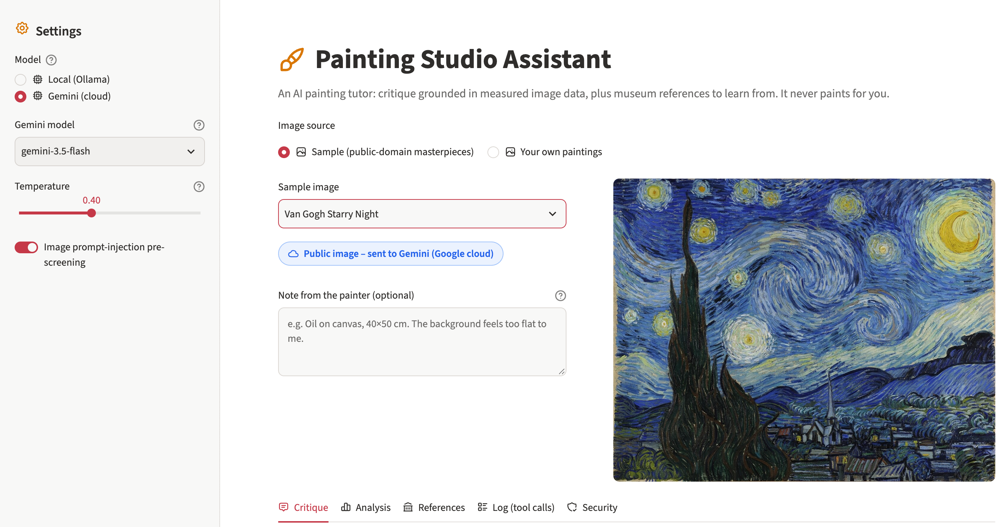

# Painting Studio Assistant (Festőműhely asszisztens)

An AI painting tutor. From a photo of a painting it gives a structured critique built on **measured image data**
(palette, values, composition) and recommends **real museum masterpieces** as learning references.
It runs on two models: **Gemini** (cloud) or a **local model** (Ollama). Your own, unpublished paintings can only
go to the local model, and this is enforced in code.



## Features

- **Measure first, then judge:** classical image processing (k-means palette, value study, visual center of mass,
  rule of thirds) produces the numbers; the LLM interprets them and adds what only the eye can judge.
- **Two skills** as `SKILL.md` files: `painting-critique` and `reference-finder`, each limited to its own tools.
- **Four tools** with JSON schemas, called in a manual tool-calling loop that works the same for Gemini and Ollama.
- **Structured output:** Pydantic schemas with a self-repair loop. The critique names the weakest area of the
  painting and gives concrete, medium-specific painting steps.
- **Museum references** from The Met and the Art Institute of Chicago (public domain only); invented artworks are
  dropped in code.
- **Security:** a separate pre-screening call detects prompt-injection text hidden in the image; output checks flag
  flattery and possible successful injections.
- **Privacy:** private artwork + cloud model = blocked; EXIF/GPS data is stripped; your paintings and results are
  stored only on your computer (`.cache/`, git-ignored).

## Installation

```bash
uv venv --python 3.12 .venv
uv pip install --python .venv/bin/python -r requirements.txt
cp .env.example .env            # then add your GEMINI_API_KEY
```

The public-domain sample images are included in `samples/`; `scripts/fetch_samples.py` downloads them again if needed.

**Gemini key:** https://aistudio.google.com/apikey (the free tier is enough). It only goes into `.env`, never into git.

> **Free tier:** about **20 requests/day per model** (each model has its own quota). A critique takes ~3–4 requests
> (pre-screening + tool calls + final JSON), a reference search ~4–6. The default model is `gemini-3.5-flash`;
> when the quota runs out, the app shows "Daily Gemini quota used up". Pick another model (e.g.
> `gemini-3.5-flash-lite`) in the **Gemini model** dropdown in the sidebar, or wait until the next day.

**Local model (Ollama):**
```bash
brew install ollama
brew services start ollama        # runs as a background service (or: ollama serve)
ollama pull qwen3-vl:8b-instruct  # default: vision + tool calling, no "thinking" (~6 GB)
ollama pull qwen3-vl:8b           # optional: "thinking" variant, for comparison
```
Run times (M5 Max): `8b-instruct` – critique ~20–30 s, references ~15–20 s; the thinking `8b` – critique ~80–100 s,
references ~3 min, with no real quality gain. On a stronger machine: `qwen3-vl:30b`. If a model cannot call tools,
the system switches to "fallback" mode automatically (the code runs the tools and passes the results in the prompt).

## Running

```bash
.venv/bin/streamlit run app.py
```

Then open http://localhost:8501

```bash
.venv/bin/python -m pytest -q                                   # unit tests (no network or LLM needed)
.venv/bin/python eval/run_eval.py --provider ollama --runs 3    # evaluation
.venv/bin/python eval/run_eval.py --provider gemini --runs 2 --images starry --no-references   # quota-friendly
```

## Project structure

```
app.py                     Streamlit UI (English; Tabler icons, friendly error messages)
assets/icons/              Tabler Icons SVGs (MIT license) – work offline
.streamlit/config.toml     Streamlit settings (upload limit: 15 MB)
.cache/                    local data, git-ignored: results/ (saved results), paintings/ (your own paintings)
assistant/
  agent.py                 orchestrator: runs skills, tool loop, self-repair
  skills.py                SKILL.md loader (progressive disclosure)
  tools.py                 tool registry (JSON schema + function, permission check)
  image_tools.py           palette (k-means), value study, composition – classical image processing
  museum.py                The Met + Art Institute of Chicago open APIs
  guard.py                 security: privacy, injection pre-screening, output checks
  schemas.py               Pydantic output schemas
  llm/                     provider-agnostic layer: gemini_provider, ollama_provider
skills/
  painting-critique/SKILL.md
  reference-finder/SKILL.md
samples/                   public-domain test images (incl. one with an injected instruction)
eval/run_eval.py           metrics: schema compliance, consistency, injection, hallucination
docs/                      documentation, presentation (Hungarian)
```

Details (in Hungarian): [docs/DOKUMENTACIO.md](docs/DOKUMENTACIO.md)
